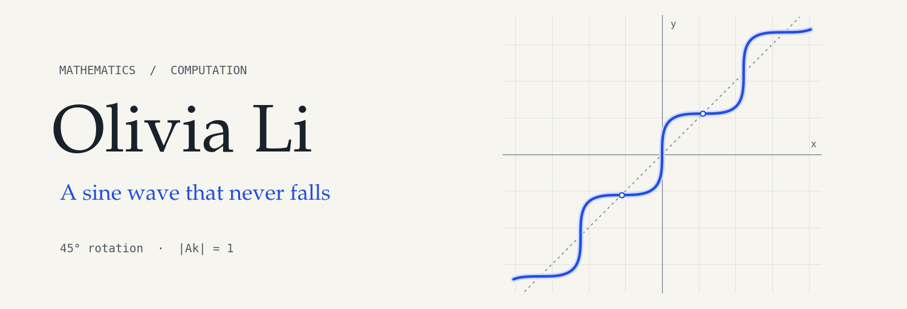

I’m interested in **mathematics, document understanding, and data tools**. I like taking a concrete question from an example to a derivation or a small tool someone else can run.

## Selected work

### [Table Grid](https://github.com/Lillyli-netizen/table-grid-cli)

A dependency-free Python CLI that turns HTML tables with merged cells into CSV or JSON. The JSON records original cell positions and spans so the output can be inspected or used downstream.

[Quickstart](https://github.com/Lillyli-netizen/table-grid-cli#quickstart) · [See input and output examples](https://github.com/Lillyli-netizen/table-grid-cli/tree/main/examples)

### [Bilingual portfolio](https://github.com/Lillyli-netizen/Me-designed-page)

An English and Chinese personal site with light and dark themes and scroll-aware navigation, built with HTML, CSS, and JavaScript.

[Open the live site](https://lillyli-netizen.github.io/Me-designed-page/)

## Notes

- [When does a rotated sine wave stop falling?](notes/rotating-a-sine-wave.md) — the question behind the cover.
- [Python learning notes](https://github.com/Lillyli-netizen/python-notes)
