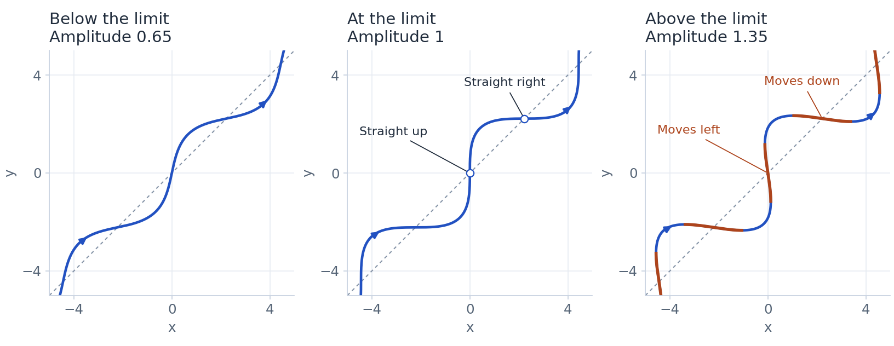
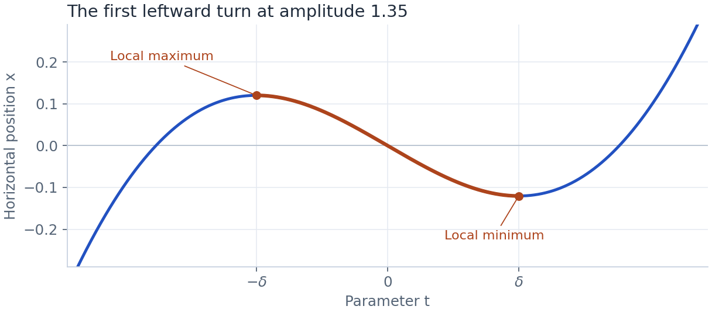

# When does a rotated sine wave stop falling?

Imagine following a sine wave along a road that runs uphill at 45°. Each crest and trough is still there when you look along the road. But from the viewpoint of the usual horizontal and vertical axes, can the path keep moving **right and up** the entire way?

Yes, up to a limit. Figure 1 shows three waves with the same tilt and wavelength. The only thing that changes is the amplitude, the wave's height measured perpendicular to its tilted centerline. The arrows show the direction of travel.



*Figure 1. The dashed line is the tilted centerline. At amplitude 1, the curve briefly points straight up or straight right, then continues uphill.*

## Start with a simpler question

Suppose we **add** an uphill trend to a sine wave. For the graph $y=mx+A\sin(kx)$, take $k>0$. Its slope is $m+Ak\cos(kx)$. The cosine term varies from $-|Ak|$ to $|Ak|$, so the smallest possible slope is $m-|Ak|$. The graph never goes down exactly when $m\ge |Ak|$.

For example, $y=x+\sin x$ has slope $1+\cos x$. Even when the sine wave pulls downhill as hard as it can, the straight-line trend cancels that effect. A true rotation adds one more question: can the curve also turn **left**?

## Rotate the wave and watch both coordinates

Start with the point $(t,A\sin(kt))$. Here $t$ locates a point along the original horizontal axis, $A$ is the amplitude, and $k>0$ sets the frequency. Rotate the point counterclockwise by an angle $\theta$ between 0° and 90°:

```math
\begin{aligned}
x(t)&=t\cos\theta-A\sin(kt)\sin\theta,\\
y(t)&=t\sin\theta+A\sin(kt)\cos\theta.
\end{aligned}
```

As $t$ increases, $x'(t)$ measures how fast the point goes right and $y'(t)$ how fast it goes up. A negative $x'(t)$ means a left turn. A negative $y'(t)$ means a descent. Their smallest values are

```math
\begin{aligned}
\min_t x'(t)&=\cos\theta-|Ak|\sin\theta,\\
\min_t y'(t)&=\sin\theta-|Ak|\cos\theta.
\end{aligned}
```

Both minima must be at least zero. Dividing by the positive sine and cosine gives the exact condition:

```math
|Ak|\le \min\{\tan\theta,\cot\theta\}.
```

**Why 45°?** A shallower tilt gives the wave less room to dip before it goes down. A steeper tilt gives it less room to wobble before it goes left. At 45° the two limits are equal, so that angle allows the largest product of amplitude and frequency. As a check, at 30° and $k=1$, doubling the amplitude from $0.5$ to $1$ crosses the descent threshold, $1/\sqrt{3}\approx 0.577$.

### What happens exactly at the limit?

At 45° with $A=k=1$, the horizontal speed is $(1-\cos t)/\sqrt{2}$ and the vertical speed is $(1+\cos t)/\sqrt{2}$. At $t=0$ the horizontal speed is zero and the curve points straight up. At $t=\pi$ the vertical speed is zero and the curve points straight right. These pauses happen at isolated points, so both coordinates are strictly increasing as functions of $t$.

Over long distances, the slope **from the origin to the point** tends to 1 as $t\to\pm\infty$. The vertical displacement from the diagonal is $y-x=\sqrt{2}\sin t$, which keeps oscillating. The secant slope has a limit even though the curve keeps wavering around the diagonal.

## Above the limit: how far does it go left?

Keep the 45° tilt and set $k=1$. Write the new amplitude as $1+\varepsilon$, where $\varepsilon>0$ is how far we are above the limit. Close to $t=0$, the horizontal coordinate first increases to a local maximum, then decreases to a local minimum. Figure 2 plots **horizontal position against the parameter** so the backward distance is the drop between those two points.



*Figure 2. The orange segment is where the point travels left. The difference in x between its endpoints is the distance it travels backward.*

The endpoints occur at $t=-\delta$ and $t=\delta$, where the horizontal velocity changes sign:

```math
x'(t)=\frac{1-(1+\varepsilon)\cos t}{\sqrt{2}},
\qquad
\delta=\arccos\!\left(\frac{1}{1+\varepsilon}\right).
```

Why does the distance scale differently from the width of the interval? Near zero, the change in cosine is quadratic, so $1-\cos\delta\approx\delta^2/2$ and $\delta\sim\sqrt{2\varepsilon}$. The point is moving left at a speed of order $\varepsilon$ over an interval of width of order $\sqrt{\varepsilon}$. Multiplying the two explains the power $3/2$. To get the constant, evaluate the displacement at the endpoints:

```math
\begin{aligned}
D(\varepsilon)
&=x(-\delta)-x(\delta)\\
&=\sqrt{2}\big((1+\varepsilon)\sin\delta-\delta\big)\\
&=\sqrt{2}(\tan\delta-\delta)\\
&\sim \frac{4}{3}\varepsilon^{3/2}.
\end{aligned}
```

The last step uses $\tan\delta-\delta\sim\delta^3/3$. Here $\sim$ means the ratio of the two sides tends to 1. An immediate check is to evaluate the exact distance and divide it by $\varepsilon^{3/2}$:

| Excess amplitude | Exact distance divided by excess amplitude to the power 3/2 |
| ---: | ---: |
| 0.1 | 1.27715 |
| 0.01 | 1.32737 |
| 0.001 | 1.33273 |

The values approach $4/3$. For a rough sense of scale, halving a small excess amplitude cuts the backward distance to about 35% of what it was.

## A next experiment: change the wave

The power $3/2$ came from the quadratic drop in cosine near its maximum. What if the waveform has a flatter maximum in its derivative? One concrete example is

```math
f(t)=\frac{9}{8}\sin t-\frac{1}{24}\sin(3t),
\qquad
f'(t)=\frac{3\cos t-\cos^3 t}{2}.
```

The derivative still ranges from $-1$ to $1$, so the critical amplitude multiplier at 45° is still 1. But $1-f'(t)$ vanishes to **fourth** order near zero. Try using that to predict the width and backward distance when the amplitude multiplier is $1+\varepsilon$. The same argument predicts powers $1/4$ and $5/4$, respectively. This is a way to test which part of the sine-wave result depends on the choice of waveform.

## Related reading

The threshold follows from differentiation. The backward distance is a short example of how a local Taylor expansion predicts what happens when a threshold is crossed. Near the origin, the critical horizontal coordinate is proportional to $t-\sin t$, the limiting form of the elliptic Kepler equation as eccentricity tends to one. Solving the inverse problem near that limit has been studied in numerical astronomy. [*An improved cubic approximation for Kepler's equation*](https://academic.oup.com/mnras/article/525/1/57/7220029)

The same sine perturbation appears in the sine circle map. The study of that map asks what happens when the transformation is applied repeatedly. [Jensen, Bak, and Bohr on the sine circle map at the critical value](https://www.nbi.dk/~mhjensen/papers/arnoldton.pdf)
